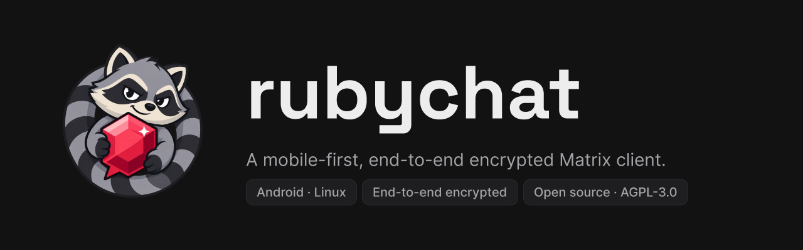
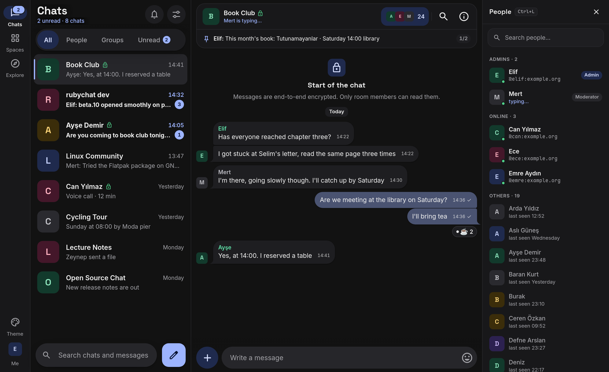
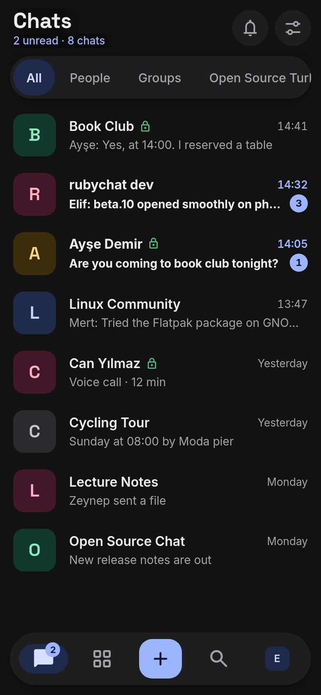
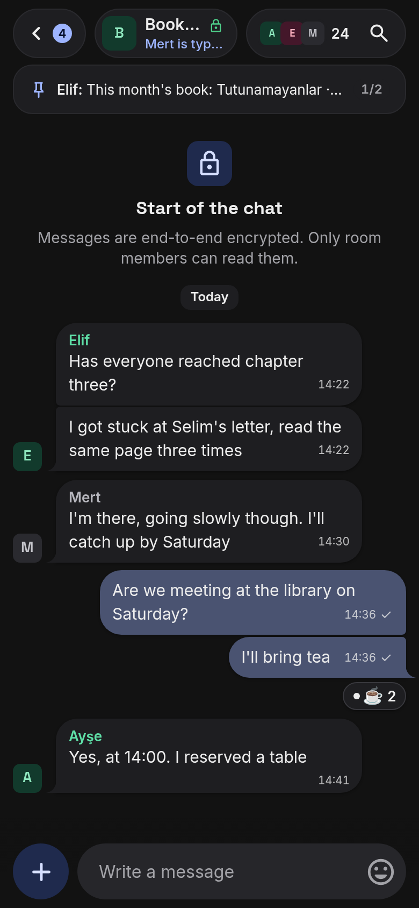
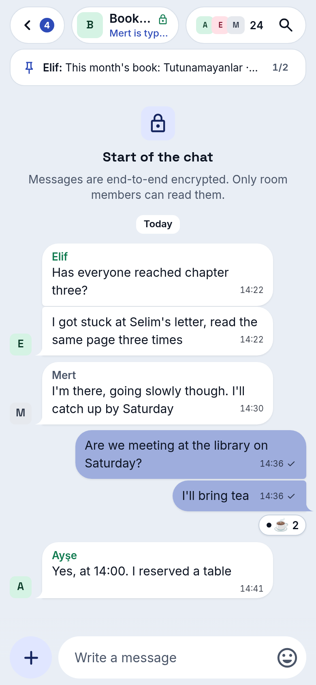
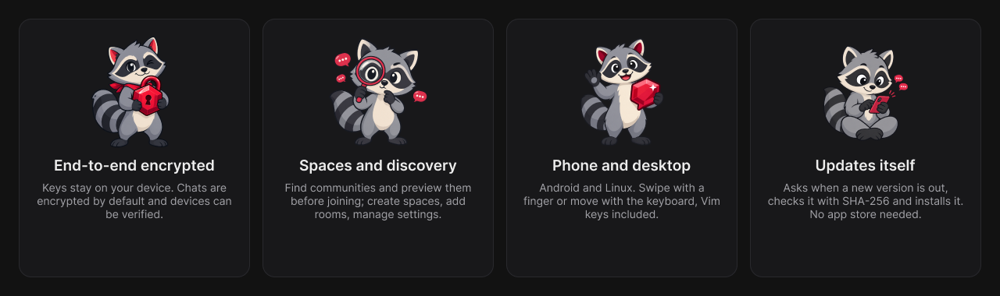

<p align="center">
  <picture>
    <source media="(prefers-color-scheme: light)" srcset="docs/readme/header-light.png">
    
  </picture>
</p>

<p align="center">
  <a href="https://github.com/Shuraimr/rubychat/releases/latest"></a>
  
  <a href="LICENSE"></a>
  <a href="https://matrix.org"></a>
</p>

<p align="center"><b>English</b> · <a href="README.tr.md">Türkçe</a></p>

rubychat is a chat app for [Matrix](https://matrix.org), the open, decentralised messaging network. It is built for the phone first and also runs on the Linux desktop. Sign in with an account on any Matrix server and talk to people on any other server. Chats are end-to-end encrypted, and the keys never leave your device.

It is part of the [rubyyard](https://github.com/Shuraimr/rubyyard) family and is written with [Tauri 2](https://tauri.app), [matrix-rust-sdk](https://github.com/matrix-org/matrix-rust-sdk) and [Svelte 5](https://svelte.dev).

> **Beta.** rubychat is young and changes quickly. Expect rough edges and report them in [Issues](https://github.com/Shuraimr/rubychat/issues).

## Download

| Platform | Package | Install |
|---|---|---|
| Android (arm64) | `rubychat-<version>.apk` | Open the file on your phone and allow installing from this source. |
| Linux (x86_64) | `rubychat-<version>-x86_64.flatpak` | `flatpak install --user --bundle rubychat-<version>-x86_64.flatpak` |

Both packages are on the [Releases](https://github.com/Shuraimr/rubychat/releases) page, each with its SHA-256. You only download once: after that rubychat tells you when a new version is out, checks the file against its SHA-256 and installs it.

## Screenshots

<p align="center">
  
</p>
<p align="center">
  
  
  
</p>
<p align="center"><sub>Screenshots are taken from the real app running with made-up demo data (see <a href="#development">Development</a>).</sub></p>

## Features

<picture>
  <source media="(prefers-color-scheme: light)" srcset="docs/readme/features-light.png">
  
</picture>

- **Messaging:** replies, edits, deletes, forwarding, reactions, pinned messages, polls, stickers and sticker packs, read receipts, typing notices.
- **Photos and video:** compressed before sending; crop photos and trim videos first.
- **Encryption:** on by default, with device verification (emoji comparison), cross-signing and key backup or recovery.
- **People and rooms:** direct messages, invites and knock requests, a People panel, and moderation (invite, kick, ban, power levels).
- **Spaces and discovery:** browse room directories on any server, preview a room before joining, and create and manage spaces.
- **Links:** `matrix.to` and `matrix:` links open in rubychat on Android and Linux.
- **Calls:** one-to-one voice calls; group calls through Element Call are experimental.
- **Search:** search chats and the messages kept on your device.
- **Sign in:** password, OAuth (the newer Matrix login, through your server's account page) or with a QR code from another signed-in device.
- **Keyboard:** a room palette on Ctrl+Space and optional Vim-style navigation (Ctrl+H / Ctrl+L, j / k).
- **Look:** dark and light themes, five accent colours, adjustable text and chat density.

What is still missing on the Matrix side is listed in [docs/MATRIX-EKSIKLER.md](docs/MATRIX-EKSIKLER.md) (Turkish).

## Development

Everything runs inside the Nix dev shell: Rust with the Android targets, Node 22, the JDK, the Android SDK and NDK, WebKitGTK and `cargo tauri`.

```sh
nix develop -c npm install
nix develop -c npm run tauri dev        # desktop app
nix develop -c npm run check            # svelte-check
nix develop -c npm run apk              # Android APK (arm64)
nix develop -c ./flatpak/derle.sh       # Flatpak bundle
```

**Demo mode.** `npm run dev`, then open `http://localhost:1420/?vitrin` in a browser (add `&dil=en` for English). The app runs without the Rust backend, using made-up data. It is only in development builds. The screenshots above come from it.

New to the code? Start with [docs/HARITA.md](docs/HARITA.md), a map of the files and where things live. The architecture is described in [docs/MIMARI.md](docs/MIMARI.md). Both are in Turkish; code comments are in English and Turkish.

## License

The code is licensed under [AGPL-3.0-or-later](LICENSE). The rubychat and rubyyard names, the raccoon mascot and the logos are not covered by the AGPL; all rights reserved (see [docs/marka](docs/marka)).
