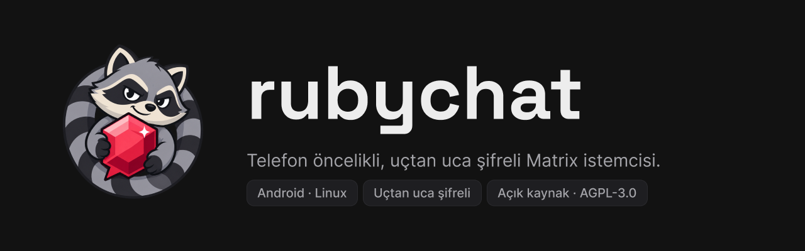
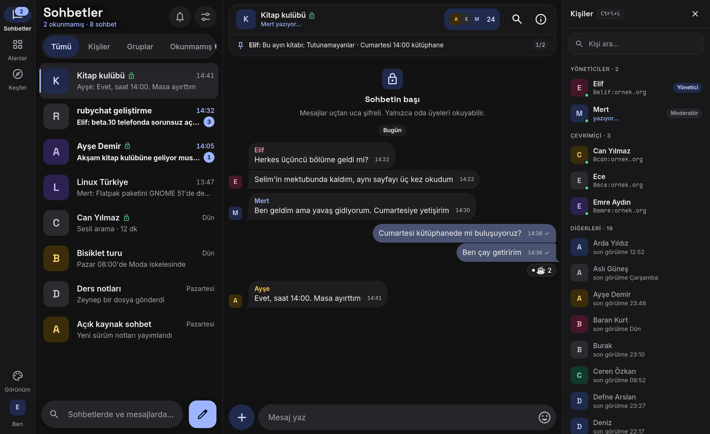
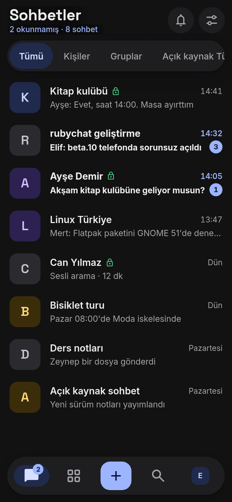
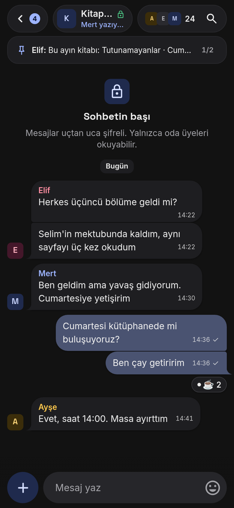
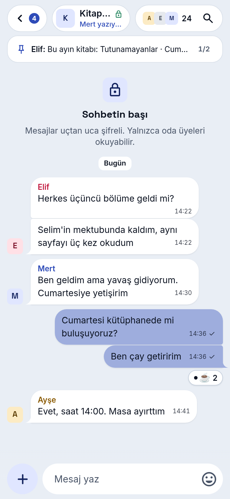
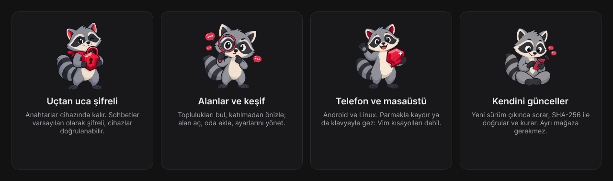

<p align="center">
  <picture>
    <source media="(prefers-color-scheme: light)" srcset="docs/readme/baslik-acik.png">
    
  </picture>
</p>

<p align="center">
  <a href="https://github.com/Shuraimr/rubychat/releases/latest"></a>
  
  <a href="LICENSE"></a>
  <a href="https://matrix.org"></a>
</p>

<p align="center"><a href="README.md">English</a> · <b>Türkçe</b></p>

rubychat, açık ve merkezsiz mesajlaşma ağı [Matrix](https://matrix.org) için bir sohbet uygulaması. Önce telefon için yapıldı, Linux masaüstünde de çalışır. Herhangi bir Matrix sunucusundaki hesabınla giriş yaparsın ve başka sunuculardaki insanlarla konuşursun. Sohbetler uçtan uca şifrelidir, anahtarlar cihazından çıkmaz.

[rubyyard](https://github.com/Shuraimr/rubyyard) ailesinin parçasıdır; [Tauri 2](https://tauri.app), [matrix-rust-sdk](https://github.com/matrix-org/matrix-rust-sdk) ve [Svelte 5](https://svelte.dev) ile yazıldı.

> **Beta.** rubychat genç ve hızlı değişiyor. Pürüzle karşılaşırsan [Issues](https://github.com/Shuraimr/rubychat/issues)'a yaz.

## İndir

| Platform | Paket | Kurulum |
|---|---|---|
| Android (arm64) | `rubychat-<sürüm>.apk` | Dosyayı telefonda aç, bu kaynaktan kuruluma izin ver. |
| Linux (x86_64) | `rubychat-<sürüm>-x86_64.flatpak` | `flatpak install --user --bundle rubychat-<sürüm>-x86_64.flatpak` |

İki paket de [Releases](https://github.com/Shuraimr/rubychat/releases) sayfasında, SHA-256 değerleriyle birlikte. Bir kez indirmen yeter: sonra yeni sürüm çıkınca rubychat sana sorar, dosyayı SHA-256 ile doğrular ve kurar.

## Ekranlar

<p align="center">
  
</p>
<p align="center">
  
  
  
</p>
<p align="center"><sub>Ekran görüntüleri, uydurma örnek verilerle çalışan gerçek uygulamadan alındı (bkz. <a href="#geliştirme">Geliştirme</a>).</sub></p>

## Özellikler

<picture>
  <source media="(prefers-color-scheme: light)" srcset="docs/readme/ozellik-acik.png">
  
</picture>

- **Mesajlaşma:** yanıt, düzenleme, silme, iletme, tepkiler, sabit mesajlar, anketler, çıkartmalar ve çıkartma paketleri, okundu bilgisi, "yazıyor" göstergesi.
- **Fotoğraf ve video:** göndermeden önce sıkıştırılır; fotoğrafı kırpabilir, videoyu kesebilirsin.
- **Şifreleme:** varsayılan olarak açık; cihaz doğrulama (emoji karşılaştırma), çapraz imza, anahtar yedeği ve kurtarma.
- **Kişiler ve odalar:** özel mesajlar, davetler ve katılma istekleri, Kişiler paneli ve yönetim (davet, çıkarma, yasaklama, yetki seviyeleri).
- **Alanlar ve keşif:** herhangi bir sunucunun oda dizinine göz at, katılmadan önce odayı önizle, alan aç ve yönet.
- **Bağlantılar:** `matrix.to` ve `matrix:` bağlantıları Android'de ve Linux'ta rubychat'te açılır.
- **Aramalar:** bire bir sesli arama; Element Call ile grup aramaları deneysel.
- **Arama:** sohbetlerde ve cihazında tutulan mesajlarda ara.
- **Giriş:** şifre, OAuth (sunucunun hesap sayfası üzerinden yeni Matrix girişi) ya da giriş yapılmış başka bir cihazdan QR kodu.
- **Klavye:** Ctrl+Space ile oda paleti; isteğe bağlı Vim tarzı gezinme (Ctrl+H / Ctrl+L, j / k).
- **Görünüm:** koyu ve açık tema, beş vurgu rengi, ayarlanabilir yazı boyutu ve sohbet sıklığı.

Matrix tarafında henüz eksik olanlar: [docs/MATRIX-EKSIKLER.md](docs/MATRIX-EKSIKLER.md).

## Geliştirme

Her şey Nix geliştirme kabuğunda çalışır: Android hedefli Rust, Node 22, JDK, Android SDK ve NDK, WebKitGTK ve `cargo tauri`.

```sh
nix develop -c npm install
nix develop -c npm run tauri dev        # masaüstü uygulaması
nix develop -c npm run check            # svelte-check
nix develop -c npm run apk              # Android APK (arm64)
nix develop -c ./flatpak/derle.sh       # Flatpak paketi
```

**Vitrin kipi.** `npm run dev` çalıştır, tarayıcıda `http://localhost:1420/?vitrin` adresini aç (İngilizce için `&dil=en`). Uygulama Rust arka ucu olmadan, uydurma verilerle çalışır. Yalnızca geliştirme derlemesinde vardır; yukarıdaki ekran görüntüleri buradan alındı.

Koda yeni misin? Dosyaların haritası [docs/HARITA.md](docs/HARITA.md)'de, mimari [docs/MIMARI.md](docs/MIMARI.md)'de. Kod yorumları İngilizce ve Türkçe.

## Lisans

Kod [AGPL-3.0-or-later](LICENSE) lisanslıdır. rubychat ve rubyyard adları, rakun maskot ve logolar AGPL kapsamında değildir, tüm hakları saklıdır (bkz. [docs/marka](docs/marka)).
